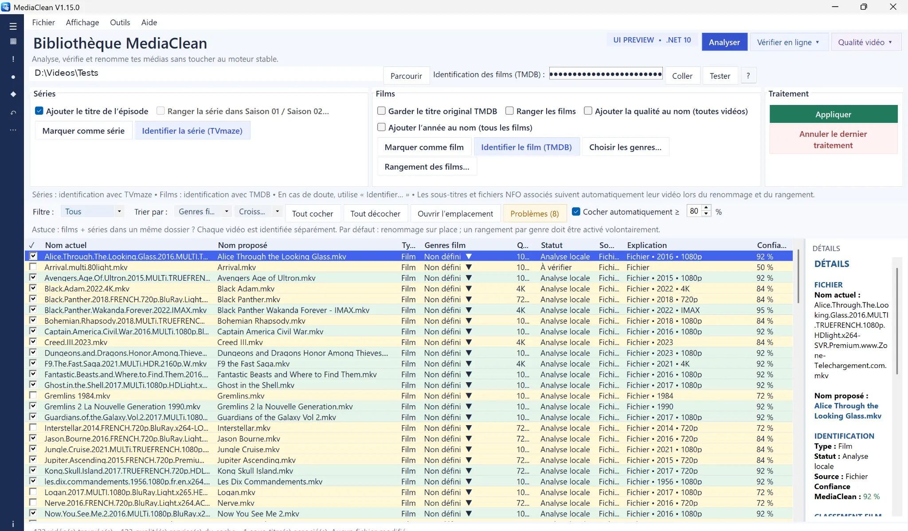
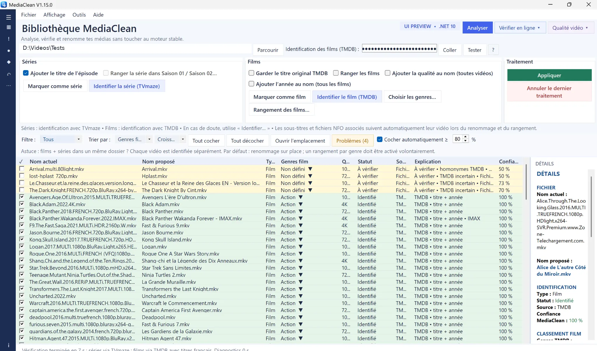
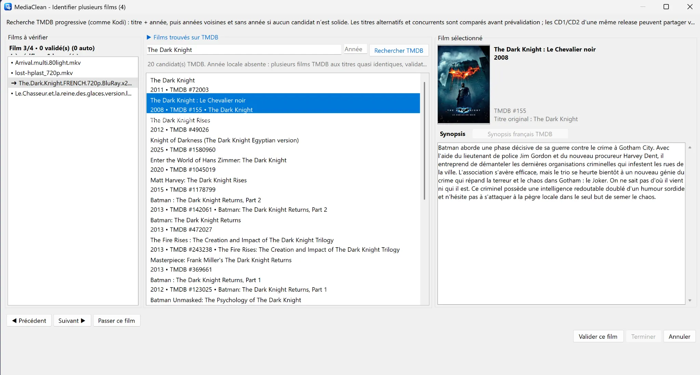

# MediaClean

**Your movies and TV shows deserve better filenames.**

MediaClean is a free Windows program to identify, rename and organize movie and TV series collections, including libraries on external drives and NAS.

**Windows x64 · Freeware · French / English interface · No subscription**

**[Download / Télécharger PRE-RC1.15.12](https://github.com/Torped00/MediaClean-Release/releases/tag/v1.15.0-pre-rc1.15.12)** · **[Report a bug / Signaler un bug](https://github.com/Torped00/MediaClean-Release/issues)**

> **PRE-RC1.15.12** is a test pre-release. The Windows build passed **431 automated regression tests**, but manual tests on real media libraries are still needed. Always test with copies first.

<!-- MEDIACLEAN_GALLERY_START -->
### MediaClean en images / Screenshots

**1. Analyse locale / Local scan** — Détection des noms de fichiers et propositions de renommage.



**2. Identification TMDB / Online matching** — Films identifiés et cas incertains à vérifier.



<details>
<summary>3. Validation manuelle / Manual TMDB selection — Voir la capture / View screenshot</summary>

Recherche TMDB avec propositions et fiche du film sélectionné.


</details>

*Captures authentiques de MediaClean 1.15.0. Chemins réseau anonymisés sur les vues principales. Les noms proposés sont des aperçus avant application. / Genuine MediaClean 1.15.0 screenshots with private network paths hidden. Proposed names are previews.*
<!-- MEDIACLEAN_GALLERY_END -->

## English

### What can it do?

- Identify **movies with TMDB** and **TV shows with TVmaze**.
- Clean technical clutter and release tags from filenames.
- Optionally organize movies by **genre** and **year**, using configurable folders.
- Review proposals before applying changes; leave uncertain identifications and conflicts untouched.
- Handle multiple editions/encodes when possible, and track changes with **Undo**.

Example (illustrative; actual results depend on matching and settings):

```text
Before: himym.s04e12.dvdrip-jmt.avi
After:  How I Met Your Mother - S04E12.avi
```

It is **not a Kodi, Plex or Jellyfin plugin**, but correctly named files can help media-center library scanning.

### What's new in PRE-RC1.15.12

- Switch the interface between **French and English**; the selected language is remembered after restart.
- UI text is translated without changing filenames, paths, custom genres or internal matching/sorting values.
- Cleaner Windows distribution with no nested ZIP, plus build information and a SHA-256 checksum.
- Better video quality recognition (including `4KLight`, `BD1080p` and `HD1080P`) and targeted resolution checks when required for sorting.
- More cautious TMDB automatic matches, especially when a significant number is missing from a proposed movie title.
- Better recovery of existing movie years and TMDB genres, while keeping manual choices.
- Safe partial processing, multiple editions, destination protection and Undo are preserved.

See the [full release notes](https://github.com/Torped00/MediaClean-Release/releases/tag/v1.15.0-pre-rc1.15.12).

### Download and safety

Visit **[PRE-RC1.15.12 Releases](https://github.com/Torped00/MediaClean-Release/releases/tag/v1.15.0-pre-rc1.15.12)**, download `MediaClean-PRE-RC1.15.12-win-x64.zip`, fully extract it, then run `MediaClean.exe`. The build includes the .NET runtime.

**SmartScreen / “Unknown publisher”:** this free personal project is **not digitally signed**, so Windows may show a warning. A warning alone does not prove a program is harmful or safe. Verify the download source and compare its SHA-256 hash with the checksum supplied alongside the ZIP. Do not disable your antivirus or SmartScreen.

```powershell
Get-FileHash .\MediaClean-PRE-RC1.15.12-win-x64.zip -Algorithm SHA256
```

**French and English interface.** Switch languages from the Language menu; your choice is remembered when MediaClean restarts.

**Freeware for personal, non-commercial use**, not open source. There is no subscription or paid feature. The program contains an **optional donation link** for anyone wishing to buy its creator a coffee or a beer. See [LICENSE.txt](LICENSE.txt) and [THIRD-PARTY-NOTICES.txt](THIRD-PARTY-NOTICES.txt).

No telemetry is described in the distribution documentation; optional TMDB, TVmaze and translation features use external services. Please do not submit private paths, credentials or API keys in [bug reports](https://github.com/Torped00/MediaClean-Release/issues).

**Source code:** this public showcase repository contains documentation only. The application’s C# source and development history remain private; GitHub's automatic “Source code” archives refer only to the showcase, **not** the app.

---

## Français

### Des années de films et de séries à ranger ?

Des disques durs pleins de vidéos, des noms à rallonge, des tags de releases, des saisons mélangées… et franchement pas envie de tout renommer à la main ? **MediaClean** est fait pour ça.

- **Identifier les films** via **TMDB** et les **séries/épisodes** via **TVmaze**.
- **Nettoyer les noms** en retirant les éléments techniques inutiles.
- **Ranger facultativement** par genre, année et arborescence personnalisée.
- **Contrôler avant d'appliquer** : les correspondances ambiguës et conflits restent à vérifier.
- **Conserver plusieurs versions** d'un film lorsque cela peut être fait sans risque.
- **Revenir en arrière** grâce au journal des opérations et à **Annuler (Undo)**.

Exemple simplifié :

```text
Avant : himym.s04e12.dvdrip-jmt.avi
Après : How I Met Your Mother - S04E12.avi
```

MediaClean **n'est pas une extension Kodi, Plex ou Jellyfin** ; il prépare les noms et dossiers pour faciliter la reconnaissance de la vidéothèque.

### Nouveautés de la PRE-RC1.15.12

- Interface au choix **français / anglais**, avec mémorisation de la langue après redémarrage.
- La traduction ne modifie ni les noms de fichiers, ni les chemins, ni les genres personnalisés, ni les valeurs internes de reconnaissance et de tri.
- Archive Windows propre, sans ZIP imbriqué, avec informations de compilation et empreinte SHA-256.
- Meilleure reconnaissance des qualités (`4KLight`, `BD1080p`, `HD1080P`...) et contrôle ciblé de la résolution réelle si le classement l'exige.
- Identification automatique TMDB plus prudente, notamment lorsqu'un numéro important disparaît du titre proposé.
- Meilleure récupération des années et des genres TMDB connus, sans remplacer les choix manuels.
- Traitement partiel, versions multiples, protection des destinations et Undo conservés.

Toutes les informations figurent dans les [notes de version complètes](https://github.com/Torped00/MediaClean-Release/releases/tag/v1.15.0-pre-rc1.15.12).

### Téléchargement

Ouvre la **[Release PRE-RC1.15.12](https://github.com/Torped00/MediaClean-Release/releases/tag/v1.15.0-pre-rc1.15.12)**, télécharge `MediaClean-PRE-RC1.15.12-win-x64.zip`, décompresse-le entièrement, puis lance `MediaClean.exe`. Aucun runtime .NET supplémentaire n'est normalement nécessaire.

La préversion **PRE-RC1.15.12** a réussi **431 auto-tests de régression**, mais nécessite encore des essais manuels. **Teste d'abord sur des copies de fichiers**, jamais directement sur ton unique vidéothèque.

**SmartScreen / « Éditeur inconnu » :** le programme **n'est pas signé numériquement**, car c'est un projet personnel gratuit. Windows peut afficher un avertissement ; ce n'est ni la preuve d'un danger, ni une preuve de sûreté. Vérifie l'origine du fichier, compare l'empreinte SHA-256 avec celle publiée pour la même Release et conserve tes protections Windows activées.

Pour vérifier le ZIP dans PowerShell :

```powershell
Get-FileHash .\MediaClean-PRE-RC1.15.12-win-x64.zip -Algorithm SHA256
```

**Interface bilingue français / anglais** : sélectionne la langue dans le menu « Langue » ; le choix est mémorisé au prochain lancement.

### Un logiciel gratuit, pour le plaisir

MediaClean est un **freeware à usage personnel et non commercial** : aucun abonnement, aucun déblocage payant. Il contient déjà **un lien de don facultatif** pour offrir un café ou une bière au développeur si le cœur t'en dit.

La documentation de distribution indique l'absence de télémétrie. Les médias restent locaux ; les fonctions d'identification et de traduction peuvent contacter des services externes.

Une anomalie ou une suggestion ? **[Signale-la ici](https://github.com/Torped00/MediaClean-Release/issues)**, sans publier de chemins personnels ou de jetons API.

Le **code C# du logiciel reste privé**. Les archives automatiques « Source code » de GitHub ne contiennent que les documents publics de la vitrine.

Licence et crédits : [LICENSE.txt](LICENSE.txt) · [THIRD-PARTY-NOTICES.txt](THIRD-PARTY-NOTICES.txt). MediaClean utilise l'API TMDB, mais n'est ni approuvé ni certifié par TMDB.
